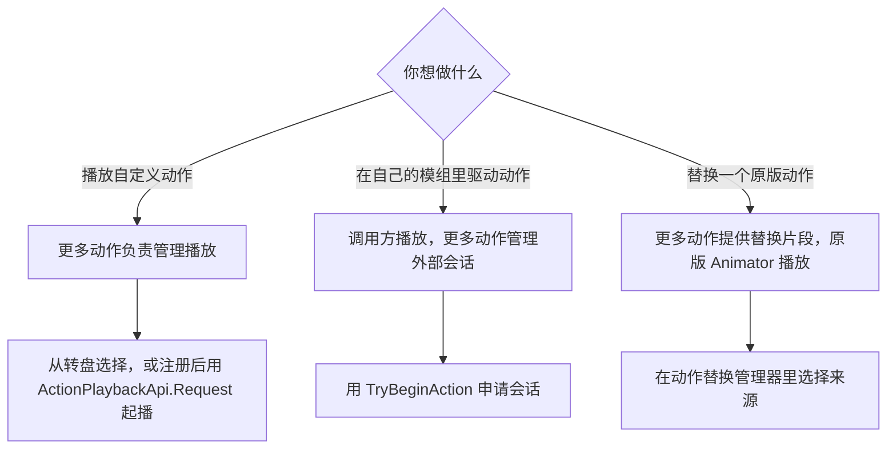
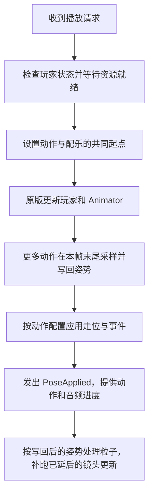
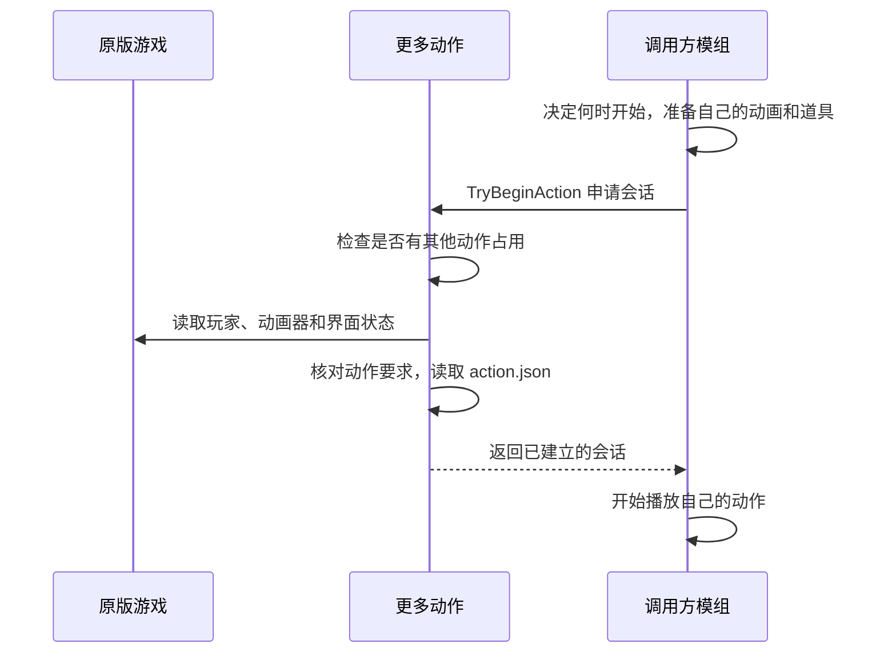
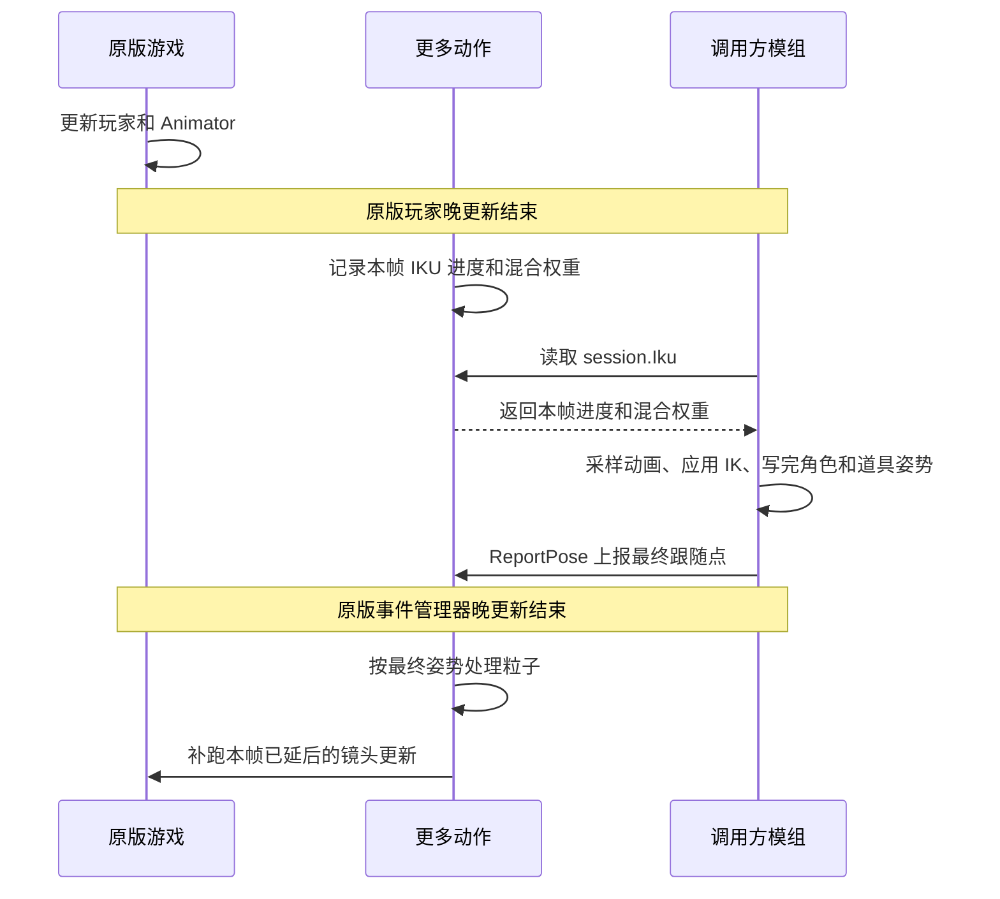
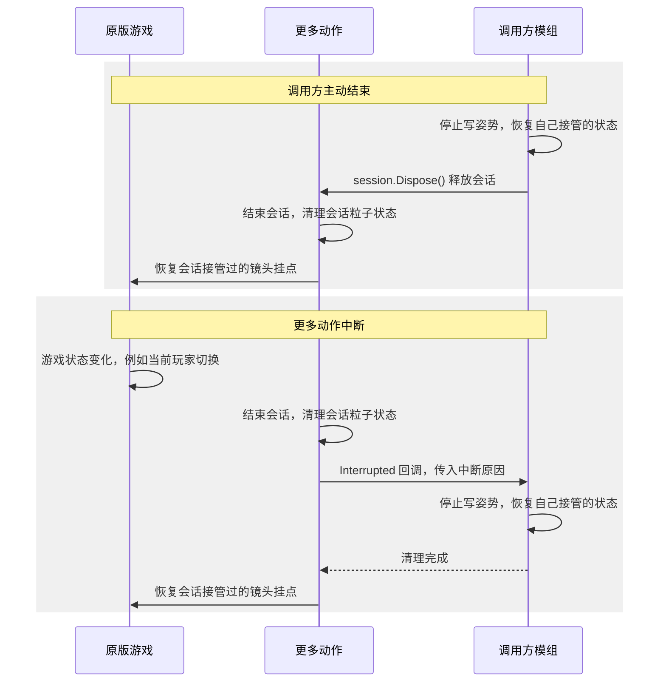

# 更多动作的播放流程与时序

[配置指南](README.zh-CN.md) · [外部 API 用法](API.zh-CN.md)

本文适用于更多动作 1.7.1。先确认谁控制播放和姿势写回，再看每帧如何更新。

## 三种用法怎么选

原动作替换继续由原版状态机决定什么时候播放。下面分别介绍自定义动作和外部会话怎么运行。

## 更多动作管理播放

玩家从转盘点选动作，或者模组通过 `ActionRegistry` 注册后调用 `ActionPlaybackApi.Request`。更多动作等待资源就绪、检查玩家能否开始，再协调动画、配乐和动作事件。

图中是普通播放帧；动作中途停止时会退出该帧的后续步骤。游戏暂停时冻结动作和配乐的时钟。停止、切换或正常播完时，更多动作释放自己占用的姿势、音频和镜头状态。

如果 Unity 独立动作配置了 `ikuClipAsset`，触发支持的原版站姿或普通蹲姿 IKU 后，主动作和配乐暂停。此时用原版动画的进度和混合权重采样专用片段；正常结束后从暂停点继续。

## 外部会话怎么接

调用方自己的代码负责播放动画、写骨骼、做 IK 和恢复自己接管的道具或输入。更多动作检查能否开始，管理动作互斥、玩家限制、已配置的属性，以及镜头跟随和原版粒子派发。

[开始交接](#开始时怎么交接) · [逐帧更新](#一帧里谁先做什么) · [结束交接](#结束时怎么交接)

### 开始时怎么交接

更多动作按资源名查找调用方 DLL 旁的 `Actions/<资源名>/action.json`。分组重载可以在同一次会话里管理多组属性。申请失败时返回 `null`，调用方可从 `reason` 读取原因，保持当前状态。

### 一帧里谁先做什么

三列分别是原版游戏、更多动作和调用方模组，时间从上往下走。图中以使用分组 API、混合专用 IKU 并上报姿势的一帧为例。

- 有专用 IKU 片段时，在更多动作采样本帧进度后、调用方写姿势前读取 `session.Iku`。早于采样读取会拿到上一次的结果。
- 需要跟随最终姿势的镜头或原版粒子时，等姿势和 IK 都写完再调用 `ReportPose`，传入两个世界坐标并标记本帧姿势已就绪。如果当帧没上报，依赖最终姿势的粒子调用可能丢失。
- 使用旧重载时，在写姿势前用 `readIku()` 当场读取原版状态，写完后用 `followCamera` 上报。

### 结束时怎么交接

图中两段是各自独立的结束方式。调用方主动结束时先清理再释放。更多动作中断时，调用方收到回调后清理。

调用方在两种情况下都要恢复自己接管的姿势、输入和道具，并清空保存的会话。镜头挂点由更多动作恢复，前提是该会话动过这些挂点且它们仍由该会话控制。
